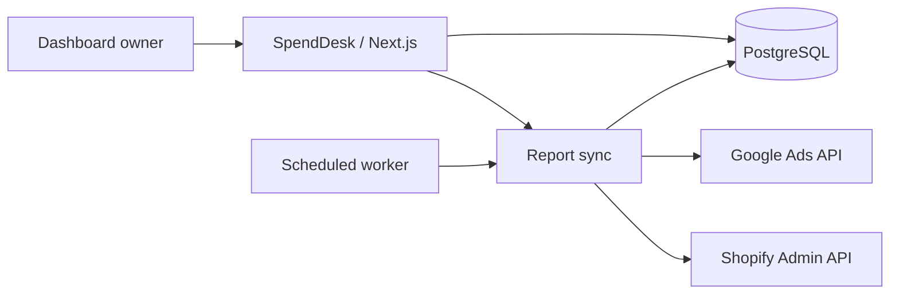

# SpendDesk

**Your Google Ads accounts and Shopify stores, in one daily workspace.**

SpendDesk is a self-hosted dashboard for a single owner managing multiple stores. Compare yesterday and today, inspect campaign budgets and spending, and organize up to 25 store–Google Ads account pairs across any number of Google logins.


## Features

- **Shopify-style date range:** Today, Yesterday, Last 7 days, Last 30 days, Month to date, or a custom range from a two-month calendar.
- **Complete CSV export:** download all connected Google accounts, store summaries, budgets, campaigns, product-level ad activity, Shopify products, and saved campaign assignments for the selected dates.
- **Dynamic Google connections:** add logins, filter by email, and reconnect without duplicating accounts or changing store assignments.
- **Store mapping:** one Google Ads customer ID (CID) per Shopify store, with optional manager-account access.
- **Google Ads reporting:** actual spend, purchase conversions, eligible source-reported cost per purchase, campaign details, and configured budgets.
- **Shopify orders:** source-reported order counts alongside ad performance. Shopify sales are hidden from the interface.
- **Product drill-down:** open a store to browse its Shopify products, reported product-level ad activity, campaign totals, and saved manual campaign assignments.
- **Budget visibility:** the store total uses current daily amounts only for campaigns enabled at any point during the selected account-local dates. Campaigns paused throughout are excluded; a one-minute run counts the full daily amount. Shared budgets count once. Pause/resume, creation, schedule dates, and budget reassignment history are checked; unavailable history is never treated as zero. Eligibility is retained with saved daily reports before Google’s 30-day change-history window expires. All configured amounts and edit history remain available in the budget history dialog.
- **Refresh and history:** manual and scheduled refreshes, source errors, and preserved last successful snapshots.
- **Budget history:** previous saved total daily budgets and their detection windows, plus exact individual budget edits imported from Google Ads' recent change history. Shared budgets count once. Older report dates never imply the budget was set on that date: configurations are recorded at the actual fetch time. Imported edits are cached daily, refreshed after detected changes with Google's reporting delay, and use the same background quota controls; opening charts adds no provider calls.
- **Order flow:** an arrow in each row opens a smooth blue period-comparison chart with a dotted comparison line, dark hover tooltip, local timestamps, date controls, and a saved-data table. Daily charts compare with the previous equal-length period or the previous calendar month, using saved daily reports. Intraday charts show cumulative counts at genuine saved update times. A gray dash means unchanged or unavailable comparisons; the pop-up explains which. Today’s figures beneath historical selections; current values versus about an hour earlier in Today view. In Today view, the indicator shows orders added (or adjusted) between saved snapshots 45–75 minutes apart, with actual elapsed minutes and timestamps. In historical views, it compares today’s Shopify order count with yesterday’s snapshot around the same local time (within 15 minutes). More than 20% below yesterday is marked Slower. Missing or stale observations are explicit. Comparison history begins at deployment, needs about an hour/day to establish the respective baselines, and is retained for eight days without additional provider requests.
- **Responsive workspace:** desktop overview, mobile navigation, search, store details, and connection management.
- **Example mode:** 25 fictitious stores for exploring the interface without provider credentials.
- **Private access:** one owner, password authentication, encrypted provider credentials, and protected APIs.

This repository contains application source and synthetic test/example data. Connected accounts, store credentials, database records, and report exports are excluded. Each installation uses its own database and provider authorizations.

## Stack

| Layer       | Technology                                                |
| ----------- | --------------------------------------------------------- |
| Application | Next.js App Router, React, TypeScript                     |
| Interface   | Tailwind CSS, shadcn/Base UI, Lucide icons                |
| Database    | PostgreSQL, SQL migrations, postgres.js                   |
| Providers   | Google Ads REST API and Shopify Admin GraphQL / ShopifyQL |
| Tests       | Node test runner with tsx; Playwright for browser checks  |
| Deployment  | Docker, Railway web service, PostgreSQL, scheduled worker |



## Quick start

Requirements: **Node.js 22.13 or later**, npm, and a supported environment for the `embedded-postgres` package. The local workflow was validated on macOS. The default setup does not require a system PostgreSQL installation.

```bash
git clone https://github.com/pratyushkashyyy/SpendDesk.git
cd SpendDesk
npm ci
npm run local
```

This starts PostgreSQL on `127.0.0.1:55432`, applies migrations, starts Next.js at **http://127.0.0.1:3000**, and enables the local reporting scheduler. Credentials and persistent PostgreSQL data are created in the ignored `.local/` directory; `.env.local` is generated automatically. The local runner does not contact Railway.

While the app is running, open the first-owner setup link in another terminal:

```bash
npm run local:setup
```

Choose a password of at least 14 characters. There is no default password. The helper opens a private link using macOS's `open` command. On other platforms, open `http://127.0.0.1:3000/setup#YOUR_SETUP_TOKEN` yourself, using the token from the local configuration. Do not share that link.

Use **Example mode** to explore the interface, or open **Connections** to configure providers and add your first store. Stop the local app and database with `Ctrl+C`; data remains available for the next run.

### Use your own local PostgreSQL

The managed runner writes `.env.local`. Use this alternative if you want to maintain that file yourself:

```bash
cp .env.example .env.local
# Fill in the local database URL and random secrets.
# Set APP_URL to http://127.0.0.1:3000.
npm run db:migrate
npm run dev
```

Create the database first. Set `ENCRYPTION_KEY` to 64 hexadecimal characters and generate separate random values for `SESSION_SECRET` and `SETUP_TOKEN` (for example, run `openssl rand -hex 32` separately for each). Keep `LOCAL_DEV_AUTH=false` for normal use.

## Connect Google Ads

1. Create a Google Cloud project, enable the Google Ads API, and obtain an appropriate access level for live-account reporting.
2. Configure Google Auth Platform and create a **Web application** OAuth client. If the app is in testing, add each authorizing email as a test user.
3. Add the exact callback URL to the OAuth client's authorized redirect URIs:

   ```text
   http://127.0.0.1:3000/api/google/callback
   https://spenddesk.unicornkart.us/api/google/callback
   ```

4. In **Connections → API settings**, save the OAuth client ID and secret.
5. Choose **Add a Google account** for each login. Connections appear by email address.
6. Add a store, enter its CID, and select the Google connection that has access. Enter a manager CID only when accessing the customer through a manager account.

### Production branding and domain

The production origin is `https://spenddesk.unicornkart.us`. Connect this hostname
to the dashboard service in Railway and set the web service's `APP_URL` to that
exact origin. Keep local development and test origins on localhost.
The previous Railway hostname redirects to the custom domain, preserving paths
and query parameters.

Use these public URLs in Google Auth Platform → Branding:

| Field | URL |
| --- | --- |
| Application home page | `https://spenddesk.unicornkart.us/about` |
| Privacy policy | `https://spenddesk.unicornkart.us/privacy` |
| Terms of service | `https://spenddesk.unicornkart.us/terms` |

The support contact is `contact-us@unicornkart.us`. Verify ownership of
`unicornkart.us` and add it to Google's authorized domains. Register
`https://spenddesk.unicornkart.us/api/google/callback` as an authorized redirect
URI on the existing Google OAuth web client before connecting Google accounts
from the new hostname. Changing the hostname does not change saved source
reports or the configured API quota.

Dashboard sessions are specific to the hostname, so sign in again on the new
domain. Existing ChatGPT connections must be updated to
`https://spenddesk.unicornkart.us/mcp` and reauthorized: OAuth issuer and resource
URLs follow `APP_URL`, and tokens issued for the old resource are not reused.

API access is now associated with the Google Cloud project; developer tokens were sunset on September 9, 2026. See [Google's access migration guide](https://developers.google.com/google-ads/api/docs/api-policy/developer-token). External OAuth apps in testing can have expiring authorizations; review [Google's OAuth guidance](https://developers.google.com/identity/protocols/oauth2) before relying on unattended refreshes.

SpendDesk makes reporting reads only. It does not change campaigns, bids, budgets, or conversions. The default API version is `v25`, configurable through the environment.

## Connect Shopify

Use each store's original `STORE.myshopify.com` domain and credentials for an app installed on that store. Custom storefront domains are not accepted as API destinations.

The connection form supports:

- **Admin API access token:** a separately authorized token for the store. This path does not automatically renew expiring tokens.
- **Client ID and client secret:** for an installed app and store in the same Shopify organization, the backend obtains an access token using the client-credentials grant when fetching reports.

ShopifyQL reporting requires `read_reports` and Level 2 protected customer data access. The product workspace also requires `read_products`. Confirm eligibility and app permissions for each installation; see [Shopify's reporting requirements](https://shopify.dev/docs/apps/build/shopifyql/graphql-admin-api). A Shopify Basic subscription alone does not establish API reporting access.

**The interface displays orders, not Shopify sales.** The current provider query also fetches and stores `total_sales` in its source snapshot. Missing reporting access is shown as an error instead of substituting calculated order totals. The default Admin API version is `2026-07`.

## Reporting rules

| Metric / behavior | Handling                                                                                                                                  |
| ----------------- | ----------------------------------------------------------------------------------------------------------------------------------------- |
| Spend             | Google's reported cost, with micros converted to currency units                                                                           |
| Purchases         | Conversions in Google's `PURCHASE` category; values may be fractional                                                                     |
| Cost per purchase | Google's cost-per-conversion metric only when all nonzero conversions are purchases and purchase count is positive; otherwise unavailable |
| Budget            | Current source configuration, separate from actual spend                                                                                  |
| Shared budget     | One entry per budget ID, with its campaigns                                                                                               |
| Shopify orders    | ShopifyQL's reported order count                                                                                                          |
| Reporting range   | Requested directly from each provider; each provider account keeps its own time zone                                                      |
| Currency          | Original source currency, with no conversion                                                                                              |
| Missing data      | Unavailable remains unavailable; missing values are not turned into zero                                                                  |
| Provider failure  | Last successful snapshot is retained with a source error                                                                                  |

SpendDesk does not calculate profit, ROAS, blended CPA, or a combined store budget. Financial values are not added across stores or currencies. Current budget settings are not presented as historical budgets.

A normal sync refreshes **today and the previous three days** to capture adjustments. Manual range refreshes request fresh provider totals and daily breakdowns, overwriting every saved date in the selected range and clearing prior errors on success. Daily records and their exact provider range snapshot are saved atomically for each store/source. Snapshots older than one hour are marked out of date, so that indicator can appear between scheduled refreshes. Saved date ranges, campaigns, and product snapshots are reused from PostgreSQL on subsequent views and exports, without an age-based provider fetch. Smaller ranges reuse complete daily coverage in the same source currency and time zone; only missing source/date gaps are fetched. Combined daily ranges leave source-only cost per purchase unavailable; refresh the exact range to obtain that provider metric. Old range-only snapshots need one manual refresh to populate daily coverage. Use Refresh for updated source data; scheduled sync continues updating recent daily reports.

The **Export report** action opens a dialog asking for 1–366 days and an end date (India time, inclusive), then queues a background UTF-8 CSV report for all stores and Google accounts. A Download CSV button appears when the report is ready and disappears after download; the temporary export file is deleted while source snapshots remain saved. Queued work survives page reloads and is recovered after interruptions. The default is seven days ending yesterday. Missing reports are prepared automatically; preparation may take a couple of minutes. It keeps source currencies separate and includes source errors instead of filling unavailable values with zero.

### Scheduled refreshes

The local scheduler refreshes **every hour**, regardless of store count. In Railway, `report-sync` runs hourly (`0 * * * *` UTC), refreshing today and the previous three source-local dates. A separate `report-sync-daily` worker refreshes all 30 days in the dashboard’s Last 30 days preset at **09:00 India time** (`30 3 * * *` UTC), including today. Scheduled workers wait for any active report sync instead of skipping their run. Manual refreshes remain available. Provider quotas still apply to both automatic and manual requests; the hourly schedule does not increase the Google Ads API allowance.

PostgreSQL advisory locks prevent overlapping sync passes. Provider requests use bounded retries and 30-second timeouts. Google Ads requests share a PostgreSQL-backed limiter across the dashboard and both workers, with at least one second between starts. Recent Ads dates are fetched together in 11 queries per hourly pass (10 report queries plus one pause/resume history query), instead of 28 separate daily report queries. The shared rolling 24-hour Explorer budget is 2,880 operations: the dashboard warns at 2,016 (70%), background requests stop at 2,304 (80%), and manual requests may use the remaining allowance. At the full limit all Google requests pause until capacity expires from the rolling window. Temporary rate limits use 30/60/120-second exponential delays plus jitter and honor longer Retry-After/RetryInfo hints; cooldowns persist across processes. Provider-reported daily exhaustion pauses Google requests for 24 hours. Successful pagination does not debit another operation; failed pages and uncertain transport attempts are counted conservatively. Usage tracks this application only, beginning at deployment; calls from other apps and earlier usage are not included. Saved reports remain readable during pauses. A quota pause is recorded as deferred Ads work, with the earliest retry time, rather than a source error or a failed Railway job. Shopify continues syncing, and skipped Ads snapshots keep their original values and timestamps. Genuine provider or database failures still fail the worker. At 24 accounts, 11 queries × 24 hourly runs requires about 6,336 operations/day before daily refreshes, so the Explorer cap cannot provide full hourly Ads coverage for every account; the governor deliberately pauses rather than exceeding the allowance.

## Deploy on Railway

Create four services in one Railway project:

| Service       | Configuration                                                                                                       |
| ------------- | ------------------------------------------------------------------------------------------------------------------- |
| `Postgres`    | Persistent PostgreSQL database                                                                                      |
| `dashboard`   | Included Dockerfile; start `npm run start`; pre-deploy `npm run db:migrate`; health check `/api/health`             |
| `report-sync` | Same source and Dockerfile; start `npm run sync -- --hourly`; cron `0 * * * *` (UTC); restart policy `NEVER`; no HTTP health check |
| `report-sync-daily` | Same source and Dockerfile; start `npm run sync -- --last30`; cron `30 3 * * *` (09:00 Asia/Kolkata); restart policy `NEVER`; no HTTP health check |

### Environment variables

| Variable                 | Web      | Worker   | Purpose                                                        |
| ------------------------ | -------- | -------- | -------------------------------------------------------------- |
| `DATABASE_URL`           | Required | Required | Same private Railway PostgreSQL connection reference           |
| `ENCRYPTION_KEY`         | Required | Required | Same 64-character hexadecimal key                              |
| `SESSION_SECRET`         | Required | —        | Random signing secret                                          |
| `SETUP_TOKEN`            | Required | —        | Random one-time enrollment token                               |
| `APP_URL`                | Required | —        | `https://spenddesk.unicornkart.us` in production; no trailing slash |
| `SYNC_SCHEDULED`         | `false`  | `true`   | Enable hourly interval checks on the worker                    |
| `GOOGLE_ADS_API_VERSION` | Optional | Optional | Defaults to `v25`; keep versions consistent                    |
| `SHOPIFY_API_VERSION`    | Optional | Optional | Defaults to `2026-07`; keep versions consistent                |
| `LOCAL_DEV_AUTH`         | `false`  | `false`  | Development override; never bypasses production authentication |

Use Railway's private database reference for `DATABASE_URL`. Generate distinct secrets outside version control. Losing `ENCRYPTION_KEY` makes saved credentials unreadable. Back up the database and encryption key separately.

After the web service is healthy:

1. Open `https://spenddesk.unicornkart.us/setup#YOUR_SETUP_TOKEN` and create the owner password. Enrollment succeeds once.
2. Register `https://spenddesk.unicornkart.us/api/google/callback` on the Google OAuth client.
3. Connect accounts and stores through the hosted interface.
4. Run a manual refresh and compare one store's source values before adding the rest.

For CLI updates, link the project with the Railway CLI and upload matching releases:

```bash
railway up --service dashboard
railway up --service report-sync
railway up --service report-sync-daily
```

Docker excludes `.env*` files and local data. `scripts/import-state.ts` is an optional private CLI utility, not a web endpoint. It accepts authenticated ciphertext encrypted with the target key and stops on owner or identity conflicts. Routine installations should connect providers through the interface.

## Development and validation

| Command                    | Purpose                                                  |
| -------------------------- | -------------------------------------------------------- |
| `npm run local`            | Start local database, migrations, app, and scheduler     |
| `npm run local:setup`      | Open the private local setup link on macOS               |
| `npm run db:local`         | Start only the managed local database                    |
| `npm run dev`              | Start Next.js using existing configuration               |
| `npm run db:migrate`       | Apply pending SQL migrations                             |
| `npm run sync`             | Run one reporting pass and exit                          |
| `npm test`                 | Run unit tests with synthetic provider fixtures          |
| `npm run test:integration` | Run integration tests against isolated local test data   |
| `npm run test:browser`     | Run browser checks against an isolated local test server |
| `npm run typecheck`        | Check TypeScript types                                   |
| `npm run build`            | Build and type-check the production application          |
| `npm run start`            | Start the production application after building          |

Integration and browser tests require the managed local database to be running. They use separate `storedesk_test` and `storedesk_browser_test` databases, not production data. Browser tests start a server on port 3100 and use installed Google Chrome; set `PLAYWRIGHT_CHROME_PATH` to your Chrome executable. Browser setup clears its own test database.

CI runs unit tests and a production build without live provider credentials. Tests cover time zones, missing versus zero values, purchase-only CPA, shared budgets, pagination, domain restrictions, encryption, and session signatures. Integration/browser checks additionally cover dynamic Google mapping, sync failures, overlap protection, owner access, and mobile navigation.

### Project layout

```text
app/                  Pages, API routes, and global styling
components/           Dashboard, sign-in UI, reusable UI components
lib/server/           Auth, encryption, database, provider clients, sync
lib/                  Reporting helpers, types, example data, scheduling
db/migrations/        Versioned PostgreSQL schema migrations
scripts/              Local runtime, migrations, sync, private imports
tests/                Unit, integration, and browser tests
.github/workflows/    Continuous integration
```

## Security and scope

SpendDesk is designed for **one owner per installation**, rather than multiple users or tenants.

Owner passwords use scrypt. Provider credentials use AES-256-GCM. Sessions are signed, HTTP-only, and secure in production. Mutations validate their origin and login attempts are rate limited. OAuth state is random, cookie-bound, expires after 10 minutes, and is consumed once. Rotating `SESSION_SECRET` revokes existing sessions.

Never commit environment files, `.local/`, provider tokens, private keys, database dumps, or screenshots of live financial data. Report potential vulnerabilities privately to the repository owner instead of posting credentials in an issue.

## Troubleshooting

| Symptom                       | Check                                                               |
| ----------------------------- | ------------------------------------------------------------------- |
| Google access blocked         | OAuth test users and the correct Cloud project/client               |
| Redirect mismatch             | Exact `APP_URL/api/google/callback` registration                    |
| Refresh authorization fails   | Reconnect the same email and review OAuth testing/publishing status |
| Shopify reporting unavailable | Installed app scopes and protected customer data eligibility        |
| Worker skips a tick           | Expected until the hourly interval has elapsed                      |
| Reports remain stale          | Sync errors; matching web/worker database and encryption key        |
| Local database port busy      | Another managed runtime using port 55432                            |

SpendDesk is independent and is not affiliated with Google, Shopify, or Railway.

## Connect SpendDesk to ChatGPT

SpendDesk exposes an authenticated Streamable HTTP MCP server at
`https://spenddesk.unicornkart.us/mcp`. In ChatGPT's Plugins interface, add a custom
MCP server with that URL and choose **OAuth**. Leave client ID/secret blank when
using automatic client registration. Sign in with your dashboard password and
select **Allow access and report refresh** when refresh permission is requested.
Read-only connections can select **Allow read-only access**. Availability depends on ChatGPT account and
workspace permissions.

Tools: `list_stores`, `get_store_reports`, `get_product_performance`,
`get_sync_status`, and `refresh_data`. Ask, for example, “Show yesterday's ad spend and orders for
my stores” or “Show campaign budgets for Store A.” The tools accept explicit
inclusive dates and read saved exact snapshots or complete daily coverage. Ask “Refresh my stores, then show
today's spend” to request new store reports. `refresh_data` runs in the background;
`get_sync_status` reports its request ID, queue/running/completed state and source
error counts. Omit dates to refresh today and the preceding three days in each
source account time zone, or pass both `from` and `to` for an exact range of at most
366 days. Overlapping refreshes are declined. Product workspace snapshots still
need preparation/refresh in the dashboard. Responses include source currencies,
time zones, timestamps and errors; hidden Shopify sales and raw provider payloads
are excluded. This connection cannot change campaigns, budgets or dashboard settings.

OAuth uses the existing owner session plus explicit consent, ChatGPT-only callback
URLs, S256 PKCE, five-minute single-use authorization codes, one-hour access tokens
and rotating 30-day refresh tokens. Token values are stored only as SHA-256 hashes.
`APP_URL` must match the dashboard's public HTTPS origin. Migration `006_mcp_oauth`
is applied by the existing pre-deploy migration command; no additional service,
provider credentials or OpenAI API key is required.

The OAuth revocation endpoint is `/api/mcp/oauth/revoke` (form-encoded `token` and
`client_id`). To revoke all MCP access as the installation owner, delete rows from
`mcp_oauth` with `kind IN ('access','refresh','code')`; this does not affect dashboard
sessions or source data. Disconnecting a client stops its use; issued access tokens
otherwise expire within one hour.

Refresh requires the separate `dashboard:refresh` OAuth scope alongside
`dashboard:read`. Existing read-only tokens retain their permissions. Refresh the
custom MCP server's tool list in ChatGPT, then reconnect/authorize SpendDesk to
grant refresh access. The consent page explicitly describes the report updates
and provider API quota use. The refresh tool is marked as a write action for the
host's normal tool-call approval flow.

## Connection authorization status

Connections shows the latest access status for each Google email and Shopify
store, independently of the selected reporting dates. Revoked Google refresh
grants and rejected/expired Shopify credentials are marked **Reauthorization
required**. Missing permissions, API settings problems and temporary provider
failures are marked **Needs attention**. Saved credentials that have not been
checked are labeled **Not checked yet**. Badges include a reason and check time.

Use **Check access** to verify every saved Google login (including those without
store mappings) and Shopify connection without preparing reports. Checks run in
the background and statuses also update during normal report/product refreshes.
Reconnect a flagged Google account with the same email; open a flagged store to
update its Shopify credentials or reauthorize/reinstall its app. Saving new
credentials resets the previous authorization warning until access is checked.
