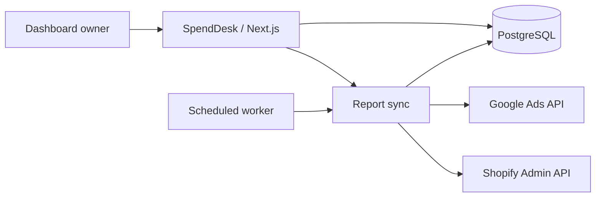

# SpendDesk

**Your Google Ads accounts and Shopify stores, in one daily workspace.**

SpendDesk is a self-hosted dashboard for a single owner managing multiple stores. Compare yesterday and today, inspect campaign budgets and spending, and organize up to 25 store–Google Ads account pairs across any number of Google logins.


## Features

- **Daily overview:** yesterday by default, today, or a custom single date.
- **Dynamic Google connections:** add logins, filter by email, and reconnect without duplicating accounts or changing store assignments.
- **Store mapping:** one Google Ads customer ID (CID) per Shopify store, with optional manager-account access.
- **Google Ads reporting:** actual spend, purchase conversions, eligible source-reported cost per purchase, campaign details, and configured budgets.
- **Shopify orders:** source-reported order counts alongside ad performance. Shopify sales are hidden from the interface.
- **Budget visibility:** distinguish daily and other budget periods, and show shared budgets once with their associated campaigns.
- **Refresh and history:** manual and scheduled refreshes, source errors, and preserved last successful snapshots.
- **Responsive workspace:** desktop overview, mobile navigation, search, store details, and connection management.
- **Example mode:** 25 fictitious stores for exploring the interface without provider credentials.
- **Private access:** one owner, password authentication, encrypted provider credentials, and protected APIs.

This repository contains application source and synthetic test/example data. Connected accounts, store credentials, database records, and report exports are excluded. Each installation uses its own database and provider authorizations.

## Stack

| Layer | Technology |
| --- | --- |
| Application | Next.js App Router, React, TypeScript |
| Interface | Tailwind CSS, shadcn/Base UI, Lucide icons |
| Database | PostgreSQL, SQL migrations, postgres.js |
| Providers | Google Ads REST API and Shopify Admin GraphQL / ShopifyQL |
| Tests | Node test runner with tsx; Playwright for browser checks |
| Deployment | Docker, Railway web service, PostgreSQL, scheduled worker |



## Quick start

Requirements: **Node.js 22.13 or later**, npm, and a supported environment for the `embedded-postgres` package. The local workflow was validated on macOS. The default setup does not require a system PostgreSQL installation.

```bash
git clone https://github.com/pratyushkashyyy/SpendDesk.git
cd SpendDesk
npm ci
npm run local
```

This starts PostgreSQL on `127.0.0.1:55432`, applies migrations, starts Next.js at **http://127.0.0.1:3000**, and enables the local reporting scheduler. Credentials and persistent PostgreSQL data are created in the ignored `.local/` directory; `.env.local` is generated automatically. The local runner does not contact Railway.

While the app is running, open the first-owner setup link in another terminal:

```bash
npm run local:setup
```

Choose a password of at least 14 characters. There is no default password. The helper opens a private link using macOS's `open` command. On other platforms, open `http://127.0.0.1:3000/setup#YOUR_SETUP_TOKEN` yourself, using the token from the local configuration. Do not share that link.

Use **Example mode** to explore the interface, or open **Connections** to configure providers and add your first store. Stop the local app and database with `Ctrl+C`; data remains available for the next run.

### Use your own local PostgreSQL

The managed runner writes `.env.local`. Use this alternative if you want to maintain that file yourself:

```bash
cp .env.example .env.local
# Fill in the local database URL and random secrets.
# Set APP_URL to http://127.0.0.1:3000.
npm run db:migrate
npm run dev
```

Create the database first. Set `ENCRYPTION_KEY` to 64 hexadecimal characters and generate separate random values for `SESSION_SECRET` and `SETUP_TOKEN` (for example, run `openssl rand -hex 32` separately for each). Keep `LOCAL_DEV_AUTH=false` for normal use.

## Connect Google Ads

1. Create a Google Cloud project, enable the Google Ads API, and obtain an appropriate access level for live-account reporting.
2. Configure Google Auth Platform and create a **Web application** OAuth client. If the app is in testing, add each authorizing email as a test user.
3. Add the exact callback URL to the OAuth client's authorized redirect URIs:

   ```text
   http://127.0.0.1:3000/api/google/callback
   https://YOUR_HOST/api/google/callback
   ```

4. In **Connections → API settings**, save the OAuth client ID and secret.
5. Choose **Add a Google account** for each login. Connections appear by email address.
6. Add a store, enter its CID, and select the Google connection that has access. Enter a manager CID only when accessing the customer through a manager account.

API access is now associated with the Google Cloud project; developer tokens were sunset on September 9, 2026. See [Google's access migration guide](https://developers.google.com/google-ads/api/docs/api-policy/developer-token). External OAuth apps in testing can have expiring authorizations; review [Google's OAuth guidance](https://developers.google.com/identity/protocols/oauth2) before relying on unattended refreshes.

SpendDesk makes reporting reads only. It does not change campaigns, bids, budgets, or conversions. The default API version is `v25`, configurable through the environment.

## Connect Shopify

Use each store's original `STORE.myshopify.com` domain and credentials for an app installed on that store. Custom storefront domains are not accepted as API destinations.

The connection form supports:

- **Admin API access token:** a separately authorized token for the store. This path does not automatically renew expiring tokens.
- **Client ID and client secret:** for an installed app and store in the same Shopify organization, the backend obtains an access token using the client-credentials grant when fetching reports.

ShopifyQL reporting requires `read_reports` and Level 2 protected customer data access. Confirm eligibility and app permissions for each installation; see [Shopify's reporting requirements](https://shopify.dev/docs/apps/build/shopifyql/graphql-admin-api). A Shopify Basic subscription alone does not establish API reporting access.

**The interface displays orders, not Shopify sales.** The current provider query also fetches and stores `total_sales` in its source snapshot. Missing reporting access is shown as an error instead of substituting calculated order totals. The default Admin API version is `2026-07`.

## Reporting rules

| Metric / behavior | Handling |
| --- | --- |
| Spend | Google's reported cost, with micros converted to currency units |
| Purchases | Conversions in Google's `PURCHASE` category; values may be fractional |
| Cost per purchase | Google's cost-per-conversion metric only when all nonzero conversions are purchases and purchase count is positive; otherwise unavailable |
| Budget | Current source configuration, separate from actual spend |
| Shared budget | One entry per budget ID, with its campaigns |
| Shopify orders | ShopifyQL's reported order count |
| Reporting day | Each provider account's own time zone |
| Currency | Original source currency, with no conversion |
| Missing data | Unavailable remains unavailable; missing values are not turned into zero |
| Provider failure | Last successful snapshot is retained with a source error |

SpendDesk does not calculate profit, ROAS, blended CPA, or a combined store budget. Financial values are not added across stores or currencies. Current budget settings are not presented as historical budgets.

A normal sync refreshes **today and the previous three days** to capture adjustments. Older single dates can be refreshed manually. Snapshots older than one hour are marked out of date, so that indicator can appear between scheduled refreshes.

### Scheduled refreshes

The worker checks every 15 minutes and skips until a store-count-based interval has elapsed. Current intervals are approximately **2 hours for 7 stores** and **6 hours 45 minutes for 25 stores**. The implementation reserves headroom for Google Ads Explorer limits; manual refreshes use the same API allowance. Adjust `lib/schedule.ts` if your access level or workload changes.

PostgreSQL advisory locks prevent overlapping sync passes. Provider requests use bounded retries and 30-second timeouts.

## Deploy on Railway

Create three services in one Railway project:

| Service | Configuration |
| --- | --- |
| `Postgres` | Persistent PostgreSQL database |
| `dashboard` | Included Dockerfile; start `npm run start`; pre-deploy `npm run db:migrate`; health check `/api/health` |
| `report-sync` | Same source and Dockerfile; start `npm run sync`; cron `*/15 * * * *`; restart policy `NEVER`; no HTTP health check |

### Environment variables

| Variable | Web | Worker | Purpose |
| --- | --- | --- | --- |
| `DATABASE_URL` | Required | Required | Same private Railway PostgreSQL connection reference |
| `ENCRYPTION_KEY` | Required | Required | Same 64-character hexadecimal key |
| `SESSION_SECRET` | Required | — | Random signing secret |
| `SETUP_TOKEN` | Required | — | Random one-time enrollment token |
| `APP_URL` | Required | — | Exact public HTTPS origin, without a trailing slash |
| `SYNC_SCHEDULED` | `false` | `true` | Enable adaptive interval checks on the worker |
| `GOOGLE_ADS_API_VERSION` | Optional | Optional | Defaults to `v25`; keep versions consistent |
| `SHOPIFY_API_VERSION` | Optional | Optional | Defaults to `2026-07`; keep versions consistent |
| `LOCAL_DEV_AUTH` | `false` | `false` | Development override; never bypasses production authentication |

Use Railway's private database reference for `DATABASE_URL`. Generate distinct secrets outside version control. Losing `ENCRYPTION_KEY` makes saved credentials unreadable. Back up the database and encryption key separately.

After the web service is healthy:

1. Open `https://YOUR_HOST/setup#YOUR_SETUP_TOKEN` and create the owner password. Enrollment succeeds once.
2. Register `https://YOUR_HOST/api/google/callback` on the Google OAuth client.
3. Connect accounts and stores through the hosted interface.
4. Run a manual refresh and compare one store's source values before adding the rest.

For CLI updates, link the project with the Railway CLI and upload matching releases:

```bash
railway up --service dashboard
railway up --service report-sync
```

Docker excludes `.env*` files and local data. `scripts/import-state.ts` is an optional private CLI utility, not a web endpoint. It accepts authenticated ciphertext encrypted with the target key and stops on owner or identity conflicts. Routine installations should connect providers through the interface.

## Development and validation

| Command | Purpose |
| --- | --- |
| `npm run local` | Start local database, migrations, app, and scheduler |
| `npm run local:setup` | Open the private local setup link on macOS |
| `npm run db:local` | Start only the managed local database |
| `npm run dev` | Start Next.js using existing configuration |
| `npm run db:migrate` | Apply pending SQL migrations |
| `npm run sync` | Run one reporting pass and exit |
| `npm test` | Run unit tests with synthetic provider fixtures |
| `npm run test:integration` | Run integration tests against isolated local test data |
| `npm run test:browser` | Run browser checks against an isolated local test server |
| `npm run typecheck` | Check TypeScript types |
| `npm run build` | Build and type-check the production application |
| `npm run start` | Start the production application after building |

Integration and browser tests require the managed local database to be running. They use separate `storedesk_test` and `storedesk_browser_test` databases, not production data. Browser tests start a server on port 3100 and use installed Google Chrome; set `PLAYWRIGHT_CHROME_PATH` to your Chrome executable. Browser setup clears its own test database.

CI runs unit tests and a production build without live provider credentials. Tests cover time zones, missing versus zero values, purchase-only CPA, shared budgets, pagination, domain restrictions, encryption, and session signatures. Integration/browser checks additionally cover dynamic Google mapping, sync failures, overlap protection, owner access, and mobile navigation.

### Project layout

```text
app/                  Pages, API routes, and global styling
components/           Dashboard, sign-in UI, reusable UI components
lib/server/           Auth, encryption, database, provider clients, sync
lib/                  Reporting helpers, types, example data, scheduling
db/migrations/        Versioned PostgreSQL schema migrations
scripts/              Local runtime, migrations, sync, private imports
tests/                Unit, integration, and browser tests
.github/workflows/    Continuous integration
```

## Security and scope

SpendDesk is designed for **one owner per installation**, rather than multiple users or tenants.

Owner passwords use scrypt. Provider credentials use AES-256-GCM. Sessions are signed, HTTP-only, and secure in production. Mutations validate their origin and login attempts are rate limited. OAuth state is random, cookie-bound, expires after 10 minutes, and is consumed once. Rotating `SESSION_SECRET` revokes existing sessions.

Never commit environment files, `.local/`, provider tokens, private keys, database dumps, or screenshots of live financial data. Report potential vulnerabilities privately to the repository owner instead of posting credentials in an issue.

## Troubleshooting

| Symptom | Check |
| --- | --- |
| Google access blocked | OAuth test users and the correct Cloud project/client |
| Redirect mismatch | Exact `APP_URL/api/google/callback` registration |
| Refresh authorization fails | Reconnect the same email and review OAuth testing/publishing status |
| Shopify reporting unavailable | Installed app scopes and protected customer data eligibility |
| Worker skips a tick | Expected until the adaptive interval has elapsed |
| Reports remain stale | Sync errors; matching web/worker database and encryption key |
| Local database port busy | Another managed runtime using port 55432 |

SpendDesk is independent and is not affiliated with Google, Shopify, or Railway.
